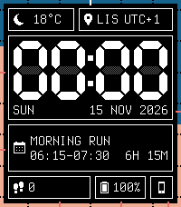
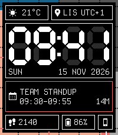
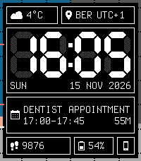
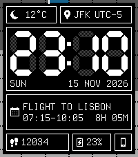

# Progressring

Like a progressbar, but in ring form: a Pebble watchface that shows the progress of the day with sunrise, sunset and events around the edge.

<p align="center">
  
  
  
  
</p>

## On the screen

- **Ring** — the whole day from midnight to midnight around the edge. The past is grey, the future is warm by day and blue by night, split by today's sunrise and sunset. A white mark shows the current time, orange marks show upcoming events, and an event in progress is filled orange.
- **Weather** — condition icon and temperature.
- **Location** — the code of the nearest airport and the time zone.
- **Clock** — big digits with the day of the week and the date.
- **Event** — the event in progress or the next one, with its time and a countdown. Today's all-day event is shown when nothing else is left today; tomorrow's first event after that.
- **Steps, battery, connection** — step count, charge level with a charging bolt, phone connection and quiet time.

Built for Pebble Time 2 (emery). Weather and calendar come from the Pebble app, so it asks for Location and Calendar permissions.

## Development

```sh
npm run build    # build/progressring.pbw
npm run shots    # screenshots/ from the data in tools/shots.json
npm run publish  # upload the built app to the Pebble appstore
```

Generated sources are committed; regenerate them only when their inputs change:

| Script | Writes | From |
| --- | --- | --- |
| `tools/gen_font.py` | `src/c/font.[ch]` | `tools/ter-u14n.bdf` |
| `tools/gen_assets.py` | `src/c/assets.[ch]` | `tools/icons.json` |
| `tools/gen_airports.py` | `src/pkjs/airports.js` | OurAirports data |

## Credits

- [Terminus Font](https://terminus-font.sourceforge.net/) by Dimitar Toshkov Zhekov, under the SIL Open Font License ([OFL-Terminus.txt](OFL-Terminus.txt)).
- Airport data from [OurAirports](https://github.com/davidmegginson/ourairports-data), public domain.
